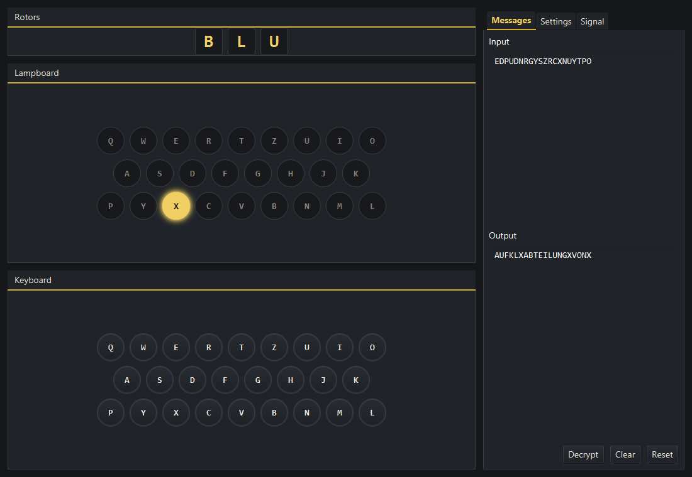
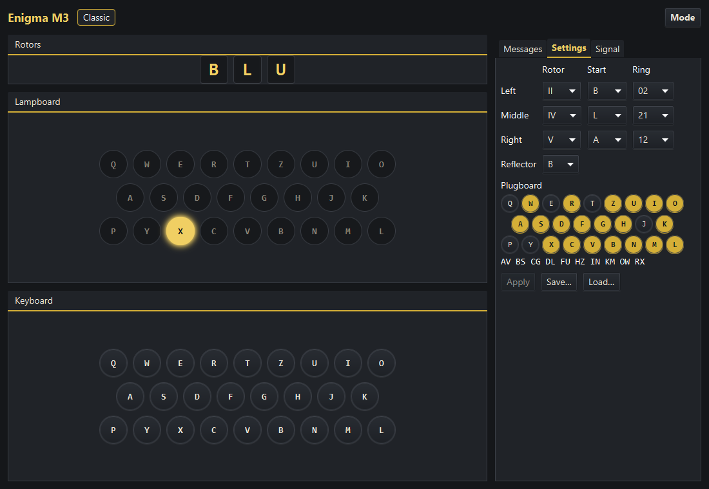
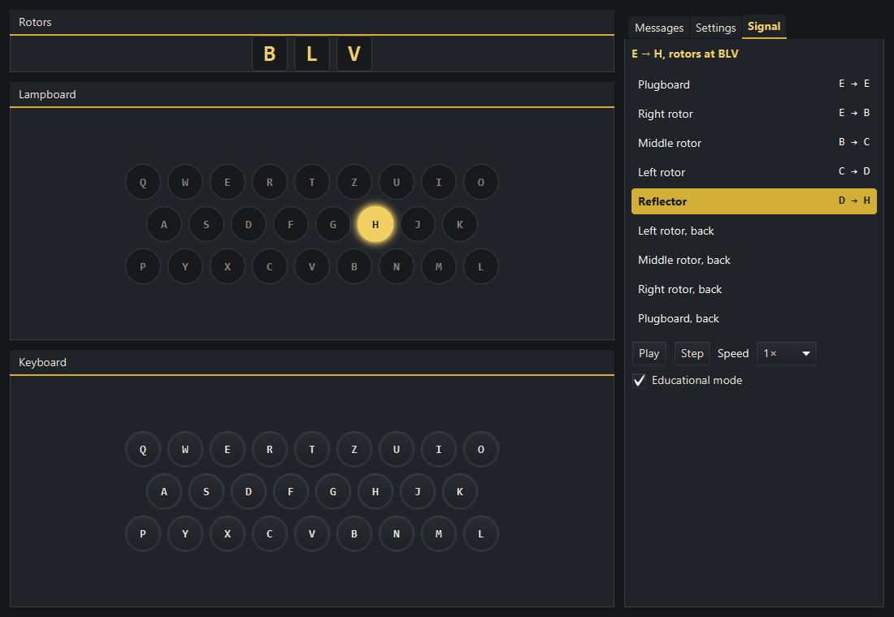
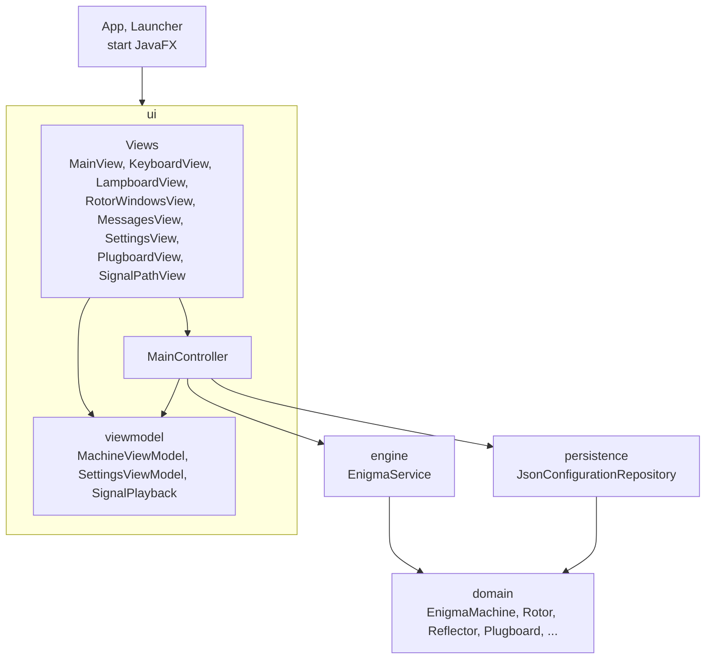
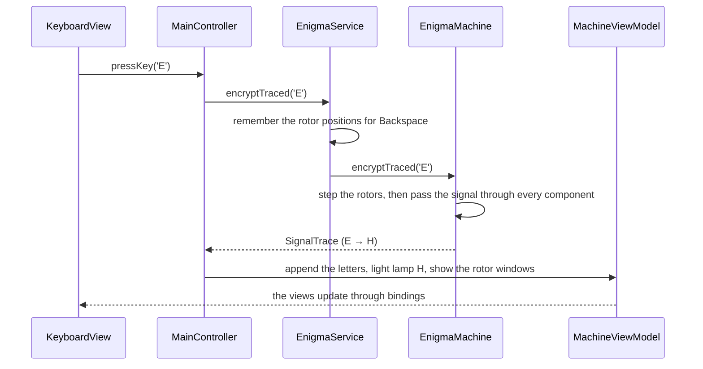

# Enigma Machine

A desktop simulator of the three-rotor Enigma M3, built to be historically accurate and easy to test and use.



## Features

- Historically accurate encryption: rotors I-V, reflectors B and C, ring settings, start positions, plugboard and the double step of the middle rotor.
- Type on the on-screen keyboard or the physical one. The lamp of the encrypted letter lights up and the rotor windows roll forward.
- Backspace, Clear, Reset and a Decrypt button that runs the output back through the machine.
- Settings are edited apart from the running machine and take effect only when applied.
- Settings can be saved to and loaded from JSON files.
- An animated signal path shows every component a letter passes through, with an educational step-by-step mode.
- Every action has a keyboard shortcut. Lamps, rotors and plugboard sockets are described for screen readers.
- Checked against real messages from 1941 by an automated test suite of more than 300 tests.

## Requirements

- JDK 25
- Maven does not need to be installed separately because the project includes the Maven Wrapper.

## Commands

On Windows:

```powershell
.\mvnw.cmd clean javafx:run   # start the application
.\mvnw.cmd test               # run the tests
.\mvnw.cmd clean verify       # run the full build and tests, and write the coverage report
```

On Linux and macOS, use `./mvnw` instead of `.\mvnw.cmd`.

After `verify`, the test coverage report is in `target/site/jacoco/index.html`.

In IntelliJ IDEA, the project includes these run configurations, listed next to the Run button:

| Configuration | What it does |
|---|---|
| Enigma Machine | Starts the application |
| All tests | Runs every test, with results shown test by test |
| Build and test | Runs `mvn clean verify`, exactly as on the command line, including the coverage report |

## User guide

### Encrypt a message

1. Start the application. The machine starts with rotors I, II, III, reflector B, all rings at 01, all positions at A and no plugboard pairs.
2. Type the message on the physical keyboard or click the keys on screen. Each letter steps the rotors, then lights the lamp of its encrypted letter.
3. The **Messages** tab shows the typed input and the encrypted output.

What gets typed:

- Only the letters A-Z are encrypted. Lowercase letters are treated as uppercase.
- A letter with diacritics becomes its base letter, so a T with comma is typed as T.
- Space is typed as X, the word separator historical operators used, so a decrypted message shows X between words.
- Digits, punctuation and other characters are ignored and do not step the rotors.
- **Backspace** removes the last letter and returns the rotors to where they were before it, which the mechanical machine could not do.

### Decrypt a message

Enigma is reciprocal: encrypting the ciphertext with the same initial settings gives back the plaintext. Rotor positions change with every letter, so decrypting from already advanced positions gives the wrong text.

- **Decrypt** runs the current output back through the machine from where the message began, so it becomes the new input.
- To decrypt a message you received, apply the settings it was encrypted with, press **Reset**, then paste the ciphertext with **Ctrl+V**. Spaces and line breaks in pasted text are skipped, so ciphertext written in groups of letters decrypts correctly.
- **Clear** empties the messages and leaves the rotors where they are. **Reset** also returns the rotors to their start positions. Letters removed with Clear cannot be undone.

### Change the settings



The **Settings** tab edits the rotor order, start positions (A-Z), ring settings (01-26), reflector and plugboard without touching the running machine.

- Choosing a rotor that is already in use swaps the two slots, so the three rotors are always distinct.
- On the plugboard, click two letters to connect them, and click a connected letter to remove its pair. The connected pairs are listed below the sockets. A note appears above 10 pairs, which was the usual limit on the M3, but up to 13 pairs are allowed.
- **Apply** starts the machine with the edited settings and empties the current message, which could no longer be decrypted with the new settings.
- **Save** writes the settings to a JSON file. **Load** fills the editors from such a file, and the machine uses them after **Apply**. A file holds only the initial settings, never a message or the positions reached while typing. A damaged or incompatible file is explained and changes nothing.

### Follow the signal



The **Signal** tab replays the path of the last letter: plugboard, the three rotors from right to left, the reflector, the rotors back from left to right and the plugboard again. **Play**, **Pause**, **Step** and the speed selector control the replay. In **Educational mode**, each new letter waits at its first step until you press Play or Step.

The letter is already encrypted when the replay starts, so none of these controls can change the result.

### Keyboard shortcuts

The buttons are deliberately left out of the Tab focus order, because a focused button would react to Space while a message is being typed. Use these shortcuts instead. On macOS, use Cmd instead of Ctrl.

| Shortcut | Action |
|---|---|
| Ctrl+1, Ctrl+2, Ctrl+3 | Show the Messages, Settings or Signal tab |
| Ctrl+D | Decrypt |
| Ctrl+L | Clear |
| Ctrl+R | Reset |
| Ctrl+V | Paste text into the machine |
| Ctrl+Enter | Apply the settings |
| Ctrl+S | Save the settings |
| Ctrl+O | Load settings |
| Ctrl+P | Play or pause the signal path |
| Ctrl+N | Next step of the signal path |
| Ctrl+E | Turn educational mode on or off |

A shortcut does nothing while its button is disabled. Each button's tooltip shows its shortcut.

## Enigma M3 model

| Component | Supported |
|---|---|
| Rotors | Three distinct rotors chosen from I, II, III, IV and V |
| Reflectors | B and C |
| Start positions | A-Z for each rotor |
| Ring settings | 01-26 for each rotor |
| Plugboard | Reciprocal letter pairs, up to 13 |
| Stepping | Rotors step before each letter, including the historical double step |

### Limitations

- Rotors VI, VII and VIII are not supported.
- Reflector A and the thin reflectors are not supported.
- The four-rotor Enigma M4 and other variants are not supported.
- Historical use of the plugboard was usually limited to 10 pairs, but the engine allows up to 13.

### Verified example

The tests decrypt both parts of a real message sent during Operation Barbarossa on 7 July 1941 and compare the result with its [published decrypt](http://wiki.franklinheath.co.uk/index.php/Enigma/Sample_Decrypts). The [settings and ciphertext](http://wiki.franklinheath.co.uk/index.php/Enigma/Sample_Messages) for the start of the first part are:

| Setting | Value |
|---|---|
| Rotors | II, IV, V |
| Reflector | B |
| Ring settings | B, U, L (02, 21, 12) |
| Start positions | B, L, A |
| Plugboard | AV BS CG DL FU HZ IN KM OW RX |

```text
Ciphertext: EDPUD NRGYS ZRCXN UYTPO
Plaintext:  AUFKL XABTE ILUNG XVONX
```

The screenshots above show this message decrypted in the application.

## Architecture

The code is split into layers, and each one depends only on the layers below it:



| Package | Responsibility | Rule |
|---|---|---|
| `domain` | The machine itself: rotors, reflector, plugboard, stepping and the signal path | No JavaFX and no file access; it can be tested on its own |
| `engine` | `EnigmaService` keeps the running machine and the history needed to undo letters | No JavaFX |
| `persistence` | Saves and loads configurations as versioned JSON | Does not depend on the UI |
| `ui` | Views, the controller and the view models | Contains no encryption logic and only shows what the engine reports |

### Classes

| Class | Role |
|---|---|
| `domain.Alphabet` | Converts between the letters A-Z and the indexes 0-25 |
| `domain.RotorDefinition` | The historical wiring and notch of rotors I-V |
| `domain.Rotor` | A rotor with its position and ring setting, mapping a signal in both directions |
| `domain.Reflector` | Reflectors B and C, which send the signal back through the rotors |
| `domain.Plugboard` | Reciprocal letter pairs that swap a letter before and after the rotors |
| `domain.MachineConfiguration` | Immutable, validated initial settings: rotors, reflector, rings, positions and plugboard |
| `domain.SteppingMechanism` | Steps the rotors before each letter, including the double step |
| `domain.EnigmaMachine` | Runs a letter through the whole machine and reports its `SignalTrace` |
| `domain.SignalTrace` | Every component one letter crossed, used by the Signal tab |
| `engine.EnigmaService` | The running machine, with the rotor positions before each letter so Backspace can undo it |
| `persistence.ConfigurationFile` | The JSON file format, with a format version |
| `persistence.JsonConfigurationRepository` | Reads and writes the files with Jackson, replacing a file only after the new one is fully written |
| `ui.MainController` | Turns user actions into engine calls and reports results instead of throwing |
| `ui.viewmodel.MachineViewModel` | Messages, lamp, rotor windows and status shown by the views |
| `ui.viewmodel.SettingsViewModel` | The settings being edited, kept apart from the running machine until applied |
| `ui.viewmodel.SignalPlayback` | Which step of the signal path is shown |
| `ui.Shortcuts` | The keyboard shortcuts of the buttons |
| `ui.UnexpectedErrorHandler` | Shows an unexpected error as a dialog instead of a stack trace |

### What happens when a key is pressed



## Testing

The tests cover the engine, the settings, the file format and the interface:

- **Engine:** rotor wiring, reflector symmetry, plugboard rules, turnover and double stepping, and real messages from 1941.
- **Settings and files:** validation, apply and reset, a JSON round trip of 500 random configurations, and damaged, incompatible or locked files.
- **Interface:** key and mouse events sent through the real view without opening a window, keyboard shortcuts and screen reader descriptions.
- **Accessibility:** the theme colours are checked against the WCAG AA contrast ratio.

## Technologies

Java 25, JavaFX 25, Jackson, Maven, JUnit 5, JaCoCo
